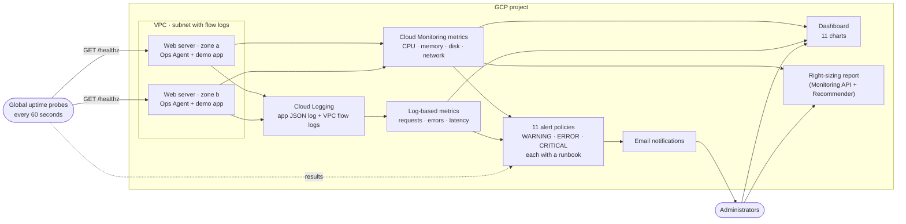

# Project 3 – Cloud Monitoring & Performance Optimization (Google Cloud + Terraform)

A complete, reusable **Infrastructure as Code** project that monitors cloud resources, finds performance bottlenecks and drives optimization on **Google Cloud**. It deploys a small web application and wraps it in a full monitoring stack: CPU, memory, disk, network and application metrics, a dashboard, tiered alert policies with built-in runbooks, global uptime checks, a load generator to prove the alerts work, and a right-sizing report that recommends where to save money.

One command (`terraform apply`) builds everything. One command (`terraform destroy`) removes it.

---

## Table of contents

1. [What it deploys](#1-what-it-deploys)
2. [Architecture](#2-architecture)
3. [How it meets the project requirements](#3-how-it-meets-the-project-requirements)
4. [Project structure](#4-project-structure)
5. [Prerequisites](#5-prerequisites)
6. [Deployment guide](#6-deployment-guide)
7. [Configuration reference](#7-configuration-reference)
8. [Try it: see the monitoring work](#8-try-it-see-the-monitoring-work)
9. [Alert policies](#9-alert-policies)
10. [Performance optimization](#10-performance-optimization)
11. [Security design](#11-security-design)
12. [Testing](#12-testing)
13. [Cost](#13-cost)
14. [Cleanup](#14-cleanup)
15. [Troubleshooting](#15-troubleshooting)
16. [Possible improvements](#16-possible-improvements)

---

## 1. What it deploys

35 resources in the default configuration, in three Terraform modules:

| Module | Resources | Purpose |
|---|---|---|
| **network** | Custom VPC, subnet with flow logs | Network telemetry and isolation |
| **workload** | Service account (logs + metrics only), 2 firewall rules, 2 static IPs, 2 VMs (one per zone) | The system being monitored: Debian VMs running the **Ops Agent** and an instrumented web app |
| **monitoring** | 3 log-based metrics, 2 uptime checks, 11 alert policies, 1 dashboard, email notification channels | The monitoring platform itself |
| *(root)* | Google API enablement, a random token | Platform wiring |

## 2. Architecture



**How the data flows:** the hypervisor reports CPU, network and disk I/O automatically. The **Ops Agent** on each VM adds memory, disk space and the application log. The app writes one JSON line per request, and log-based metrics turn those lines into request, error and latency metrics. Alert policies watch all of it and email the team with a runbook. The dashboard shows the same data for humans, and the report turns it into right-sizing advice.

## 3. How it meets the project requirements

| Requirement | How this project delivers it |
|---|---|
| **Comprehensive** – CPU, memory, storage, network and application metrics monitored continuously | **CPU** (hypervisor metric), **memory** and **disk space** (Ops Agent), **disk I/O**, **network** in and out plus VPC flow logs, and **application** request rate, 5xx errors and latency percentiles from log-based metrics. Plus availability from global uptime checks. All on one dashboard. |
| **Accurate** – alerts and reports give reliable insights | Alerts must hold for a duration (no one-second blips), evaluate **per VM**, use **p95 latency** instead of averages, and fire on uptime only when **several locations** agree. Every threshold is validated. The right-sizing report uses p95, not averages. 16 automated tests check the design. |
| **Efficient** – utilization optimized to improve performance and reduce costs | `underutilized` alert flags over-provisioned VMs. `scripts/optimization-report.ps1` reads real utilization and gives a verdict (over-sized, well-sized, under-sized) per VM, plus Google Recommender suggestions. [Optimization playbook](docs/OPTIMIZATION_PLAYBOOK.md) covers right-sizing, idle resources, discounts and autoscaling. |
| **Proactive** – automated alerts notify administrators before critical failures | **Tiered alerts:** CPU WARNING at 70% *before* CRITICAL at 90%; memory and disk alert at 85% and 80%; slow-request and error alerts catch user impact early; a VM-stopped alert and per-server uptime alerts. Email notifications carry a runbook. `scripts/generate-load.ps1` proves it by triggering real alerts. |
| **Well-documented** – dashboards, alert policies and optimization strategies recorded | This README, [`docs/MONITORING_GUIDE.md`](docs/MONITORING_GUIDE.md) (what is measured and how to read the dashboard), [`docs/ALERT_POLICIES.md`](docs/ALERT_POLICIES.md) (all 11 policies, thresholds and first actions), [`docs/OPTIMIZATION_PLAYBOOK.md`](docs/OPTIMIZATION_PLAYBOOK.md) (strategies and review rhythm). Every alert policy also embeds its own runbook. |

## 4. Project structure

```
project-3-cloud-monitoring-performance-optimization/
├── README.md                      # this file
├── versions.tf                    # Terraform + provider version constraints
├── main.tf                        # APIs, token, module wiring
├── variables.tf                   # all inputs (with validation)
├── outputs.tf                     # URLs, dashboard link, alert names, summary
├── terraform.tfvars.example       # copy to terraform.tfvars and edit
├── .terraform.lock.hcl            # pinned provider versions (commit this)
├── .gitignore                     # keeps state, tfvars, reports and credentials out of git
├── modules/
│   ├── network/                   # VPC + subnet with flow logs
│   ├── workload/                  # VMs, service account, firewall, static IPs
│   │   └── files/                 # startup.sh, app.py, ops-agent-config.yaml
│   └── monitoring/                # channels, uptime checks, log metrics, alerts, dashboard
├── scripts/
│   ├── generate-load.ps1          # create real load to trigger the alerts
│   └── optimization-report.ps1    # right-sizing report from live utilization
├── docs/
│   ├── MONITORING_GUIDE.md
│   ├── ALERT_POLICIES.md
│   └── OPTIMIZATION_PLAYBOOK.md
└── tests/
    └── monitoring.tftest.hcl      # offline tests (providers mocked, no GCP account needed)
```

## 5. Prerequisites

| Need | Notes |
|---|---|
| **Terraform ≥ 1.9** | [Install guide](https://developer.hashicorp.com/terraform/install) (Windows: `winget install Hashicorp.Terraform`). |
| **A GCP project with billing enabled** | Link a billing account in the [console](https://console.cloud.google.com). |
| **Google Cloud CLI (`gcloud`)** | [Install guide](https://cloud.google.com/sdk/docs/install). Used for login and the scripts. |
| **Permissions** | `Owner` on the project (or Editor + Project IAM Admin + Monitoring Admin + Service Usage Admin). |
| **An email address** | To receive alert notifications (optional but recommended). |

## 6. Deployment guide

**1. Log in** (opens a browser each time)

```bash
gcloud auth login
gcloud auth application-default login
```

**2. Select your project**

```bash
gcloud config set project YOUR_PROJECT_ID
gcloud auth application-default set-quota-project YOUR_PROJECT_ID
```

**3. Configure** – copy the example file and set your project and email:

```bash
cd project-3-cloud-monitoring-performance-optimization
cp terraform.tfvars.example terraform.tfvars      # PowerShell: Copy-Item terraform.tfvars.example terraform.tfvars
```

Edit `terraform.tfvars`: set `project_id` and `alert_emails = ["you@example.com"]`.

**4. Initialize and preview**

```bash
terraform init
terraform plan
```

You should see **35 resources to add** (36 with one alert email: each address adds one notification channel).

**5. Deploy**

```bash
terraform apply
```

Type `yes`. It takes about 2–3 minutes. **Then wait 4–5 minutes:** the VMs are still installing the Ops Agent and starting the app, and the first metrics take a few minutes to appear.

**6. Open the results**

```bash
terraform output app_urls
terraform output dashboard_url
```

Open the dashboard link, and the app URLs in a browser (you should see the status page; `/healthz` returns `ok`).

## 7. Configuration reference

All variables live in `variables.tf`. Only `project_id` is required.

| Variable | Default | Description |
|---|---|---|
| `project_id` | *(required)* | GCP project ID |
| `region` / `zones` | `us-central1` / two zones | One monitored VM per zone (1–3 zones) |
| `environment` | `dev` | `dev`, `staging` or `prod` |
| `name_prefix` | `cloudmon` | Name prefix (3–12 chars, lowercase) |
| `machine_type` | `e2-small` | VM size |
| `alert_emails` | `[]` | Email addresses that receive alerts |
| `alert_duration_seconds` | `120` | How long a condition must hold before alerting (use 300+ in production) |
| `cpu_warning_threshold` | `0.7` | CPU (0–1) for the WARNING alert |
| `cpu_critical_threshold` | `0.9` | CPU (0–1) for the CRITICAL alert (must exceed the warning) |
| `memory_threshold_percent` | `85` | Memory used (%) alert |
| `disk_threshold_percent` | `80` | Disk used (%) alert |
| `network_threshold_mbps` | `20` | Outbound MB/s per VM alert |
| `latency_threshold_ms` | `500` | p95 latency alert |
| `error_threshold_count` | `5` | HTTP 5xx in 5 minutes alert |
| `underutilized_cpu_threshold` / `underutilized_hours` | `0.05` / `6` | Over-provisioned VM alert |
| `allowed_http_cidrs` | `["0.0.0.0/0"]` | Who may reach the demo site (narrow to your own IP for a private demo) |
| `enable_iap_ssh` | `true` | SSH only through Identity-Aware Proxy |
| `extra_labels` | `{}` | Extra labels for all resources |

**Outputs:** `app_urls`, `instance_names`, `dashboard_url`, `alert_policy_names`, `notification_channels`, `demo_token` (sensitive), `monitoring_summary`.

## 8. Try it: see the monitoring work

Monitoring is only convincing when you can watch it react. After the VMs have been up for about 5 minutes:

**1. Create load.** It burns CPU on every server, sends slow requests and triggers server errors for 6 minutes:

```powershell
powershell -ExecutionPolicy Bypass -File scripts\generate-load.ps1
```

**2. Watch it.** Open `terraform output dashboard_url`:

| What you see | Where |
|---|---|
| CPU rising toward 100%, latency p95 climbing, a spike of 5xx errors | Dashboard charts |
| WARNING and CRITICAL incidents opening | Console → **Monitoring → Alerting** |
| The notification email with the runbook | Your inbox (if `alert_emails` is set) |

Alerts fire after the condition holds for `alert_duration_seconds` (2 minutes by default). When the load stops, incidents close on their own within about 30 minutes.

**3. Optional: memory pressure.** On its own (so it cannot starve the CPU test):

```powershell
powershell -ExecutionPolicy Bypass -File scripts\generate-load.ps1 -Stage memory -Minutes 4
```

**4. Generate the performance report:**

```powershell
powershell -ExecutionPolicy Bypass -File scripts\optimization-report.ps1 -Hours 1
```

It prints average, p95 and max CPU and memory per VM with a right-sizing verdict and saves `reports\performance-report.md`. Right after the load test the verdict will read *under-sized* (CPU was saturated on purpose); on an idle system it reads *over-sized*. A week of real data gives the verdict you should act on.

**Console pages worth showing:** **Monitoring → Dashboards**, **Alerting** (policies and incidents), **Uptime checks**, **Metrics Explorer**, **Logging → Logs Explorer**, **Compute Engine → VM instances → Observability** tab.

## 9. Alert policies

Eleven policies in three tiers (details and first actions in [`docs/ALERT_POLICIES.md`](docs/ALERT_POLICIES.md)):

| Tier | Policies |
|---|---|
| **WARNING** | CPU above 70%, outbound network above 20 MB/s, VM over-provisioned (CPU below 5% for 6 h) |
| **ERROR** | Memory above 85%, disk above 80%, p95 latency above 500 ms |
| **CRITICAL** | CPU above 90%, 5+ server errors in 5 minutes, website down (one per server), VM stopped reporting |

## 10. Performance optimization

| Tool | What it does |
|---|---|
| Dashboard | Spot bottlenecks: compare CPU, memory, disk, network and latency on one screen |
| `underutilized` alert | Flags VMs that are bigger than they need to be |
| `scripts/optimization-report.ps1` | Right-sizing verdict per VM from live data, plus Google Recommender suggestions |
| [`docs/OPTIMIZATION_PLAYBOOK.md`](docs/OPTIMIZATION_PLAYBOOK.md) | Strategies: right-sizing, idle resources, committed-use and Spot discounts, autoscaling, keeping logs lean |

## 11. Security design

| Control | Implementation |
|---|---|
| **Least-privilege identity** | The VMs run as a dedicated service account that can only write logs and metrics. |
| **No public SSH** | SSH only through Identity-Aware Proxy (`gcloud compute ssh --tunnel-through-iap`), OS Login on, project-wide SSH keys blocked. |
| **Hardened VMs** | Shielded VM: Secure Boot, vTPM, integrity monitoring. |
| **Exposure** | Only port 80 is open, and only for the demo website; set `allowed_http_cidrs` to your own IP to restrict it. |
| **Protected test endpoints** | `/cpu`, `/mem`, `/slow` and `/error` need a random 20-character token (generated by Terraform, never logged); without it they return 403. |
| **Log hygiene** | The app never logs query strings, so the token does not appear in logs. |
| **Secrets** | `.gitignore` excludes `*.tfvars`, state files, reports and key files. The token is a sensitive output. |

## 12. Testing

The project ships with an automated test suite that runs **without a GCP account** by mocking the providers.

```bash
terraform init -backend=false
terraform fmt -check -recursive      # formatting
terraform validate                   # syntax and references
terraform test                       # 16 offline tests
```

| Test | Asserts |
|---|---|
| `all_resource_areas_are_monitored` | Alerts cover cpu, memory, storage, network, application, availability; three log-based metrics; two VMs |
| `every_filter_names_a_resource_type` | Every alert and dashboard filter names a `resource.type` (Google rejects filters without one; found during the first real deployment) |
| `availability_is_checked_per_server` | One uptime check and one alert per server, plus a VM-stopped alert |
| `dashboard_has_resource_application_and_availability_charts` | At least ten widgets including memory, latency, errors and health checks |
| `alerts_are_tiered_so_warnings_come_first` | WARNING, ERROR and CRITICAL tiers; both CPU warning and critical alerts |
| `notification_channels_follow_the_email_list` | One email channel per address |
| `over_provisioned_vms_are_flagged` | The cost-optimization alert exists |
| `monitored_servers_are_hardened` | Shielded VMs, SSH only from the IAP range, service account limited to logs and metrics |
| `ssh_rule_can_be_disabled`, `single_zone_is_supported` | Optional behaviour works |
| 6 × `rejects_*` | Critical threshold below warning, invalid email, too many zones, out-of-range percent, too-short alert duration, bad environment |

**Verified results:** `terraform fmt -check` clean, `terraform validate` successful, `terraform test` → **16 passed, 0 failed** (Terraform 1.17.1; `hashicorp/google` 6.50.0, `random` 3.9.1). The Python app and both PowerShell scripts parse without syntax errors. I confirmed the tests are meaningful by temporarily changing the memory alert's coverage area; the coverage test failed as expected, then I reverted it. One test failed on its first run because of a type mismatch in the test itself (tuple versus list); it was fixed in the test, not the infrastructure.

> These are plan-time tests against mocked providers. They prove the configuration is valid and enforces the design. They **cannot** prove that Google accepts every alert filter, the dashboard JSON, or that the Ops Agent installs cleanly; a real `terraform apply` (section 6) and the load test (section 8) do that.

## 13. Cost

Two `e2-small` VMs and two static IPs (free while attached) cost roughly **$0.04–0.06 per hour** in total. Cloud Monitoring itself is essentially free at this scale (Ops Agent and hypervisor metrics, the first million uptime-check executions per month, and a small log volume). A demo of a few hours costs **a few cents to well under a dollar**. Left running all month it would be about $35–45, so destroy it when you are done. Costs that grow with real use: log volume and custom metrics.

## 14. Cleanup

```bash
terraform destroy
```

Type `yes`. Because the VMs disappear, the *VM stopped reporting* and *website down* alerts may briefly open incidents and email you; this is expected and the incidents close on their own. The enabled Google APIs stay on by design. To remove absolutely everything, delete the project: `gcloud projects delete YOUR_PROJECT_ID`.

## 15. Troubleshooting

| Symptom | Cause / fix |
|---|---|
| `API has not been used in project ... or it is disabled` | The API was just enabled and needs a minute to propagate. Re-run `terraform apply`. |
| Alert policy or dashboard creation fails with `Field ... invalid` | Paste the full error to the maintainer; a Google API filter or schema detail may need adjusting. |
| `Error 409 ... already exists` after an interrupted run | A resource was created but not recorded. Delete it (console or `gcloud`), or `terraform import` it, then re-run. |
| Dashboard has no memory or disk data | The Ops Agent is still installing (wait 5–10 minutes) or failed. Over IAP SSH run `sudo systemctl status google-cloud-ops-agent`. |
| No application metrics (requests, errors, latency) | No traffic yet: open the app URL a few times. Also check `sudo systemctl status demo-app` and `/var/log/demo-app/app.log`. |
| App URL times out | The VM is still booting (wait 3–4 minutes) or `allowed_http_cidrs` excludes your IP. |
| `/cpu` or `/slow` returns 403 | Missing or wrong token. Use `scripts\generate-load.ps1`, or `terraform output -raw demo_token`. |
| No alert email | Confirm the address in `alert_emails`, check spam, and look at **Monitoring → Alerting → Edit notification channels** for a pending verification. |
| Alerts do not fire during the load test | Conditions must hold for `alert_duration_seconds` (2 minutes) and the first data takes a few minutes to arrive. Run the test for the full 6 minutes. |
| `optimization-report.ps1` says no CPU data | Wait 5–10 minutes after deploy and run it again. |
| `gcloud` not found | Add the Cloud SDK `bin` folder to `PATH` or reopen the terminal. |

## 16. Possible improvements

- **Forecast alerts** (Cloud Monitoring can warn that a disk *will* fill within hours).
- **Service Level Objectives (SLOs)** and burn-rate alerts for the application.
- **Managed instance group with autoscaling** so the monitoring data drives scaling directly.
- **More notification channels:** Slack, SMS, PagerDuty or Pub/Sub, added to the same policies.
- **A billing budget with alerts** to monitor cost as closely as performance.
- **Remote Terraform state** in a Cloud Storage bucket for team use.
